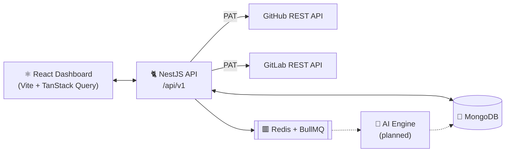

<div align="center">

# 🧠 AI GitHub Code Intelligence Agent

**An engineering intelligence platform that tracks commits and pull requests across GitHub and GitLab, and turns them into code-quality and risk insights.**

[](https://nestjs.com/)
[](https://react.dev/)
[](https://www.typescriptlang.org/)
[](https://www.mongodb.com/)
[](https://docs.bullmq.io/)
[](https://vite.dev/)
[](https://tailwindcss.com/)

[Features](#-features) •
[Architecture](#-architecture) •
[Getting Started](#-getting-started) •
[API](#-api-overview) •
[Roadmap](#-roadmap) •
[Docs](#-documentation)

</div>

---

## 📖 Overview

Engineering teams often struggle with inconsistent manual reviews, late detection of risky changes, and poor visibility into the health of their codebases.

**AI GitHub Code Intelligence Agent** connects to your repositories, pulls in commit and pull-request activity, and gives you a single dashboard to browse, review, and act on that activity. The AI evaluation engine, which is in development, will score each change for **security**, **maintainability**, and **quality**, and flag risky pull requests before they merge.

### Why it exists

| Problem | What this project does about it |
| :--- | :--- |
| Inconsistent manual code reviews | Automated, structured AI evaluation of every commit and PR |
| Risk discovered too late | Weighted risk scoring on diff size and breaking changes |
| Low visibility into engineering health | KPI dashboard covering velocity, open PRs, and critical risks |
| No objective quality metrics | Per-change scores for security, maintainability, and quality |

---

## ✨ Features

### Available now
- 🔗 **Multi-provider support:** connect **GitHub** and **GitLab** repositories through one common provider interface.
- 🔐 **Secure token storage:** Personal Access Tokens are encrypted with **AES-256-GCM** (scrypt-derived keys) and are never returned to the frontend.
- 🔀 **Commit tracking:** fetch commits for a date range, then search and paginate them, with per-commit diff stats.
- 🔃 **Pull request management:** fetch PRs/MRs, view changed files and diffs, read and post comments, and **merge** or **close** PRs from the dashboard.
- 📊 **Analytics dashboard:** KPI cards plus velocity charts built with Recharts.
- 🏥 **Health monitoring:** Terminus health checks for MongoDB and memory heap.
- ⚙️ **Production-minded backend:** Helmet, compression, CORS, Winston logging, and typed configuration.

### In development
- 🤖 AI commit and PR evaluation (OpenAI / Gemini)
- ⚠️ Risk scoring and architecture-impact analysis
- 💬 A GitHub App that posts AI review comments on PRs automatically
- 📈 Developer leaderboards and risk-trend analytics

---

## 🏗 Architecture



**Data flow (current):** the user triggers a fetch from the UI → the NestJS API calls the GitHub or GitLab REST API with the decrypted PAT → results are normalized and upserted into MongoDB → the React dashboard reads them back.

**Target flow:** GitHub Webhook → NestJS → BullMQ Queue → AI Engine → MongoDB → Dashboard and automated PR comment.

### Tech stack

| Layer | Technologies |
| :--- | :--- |
| **Frontend** | React 19, Vite 7, TypeScript, TailwindCSS 4, TanStack Query, React Router 7, Recharts, Lucide Icons, React Markdown, Prism.js |
| **Backend** | NestJS 11, Mongoose 9, BullMQ, ioredis, class-validator, Winston, Helmet, Terminus |
| **Data** | MongoDB 7, Redis 7.2 |
| **DevOps** | Docker, Docker Compose, Redis Commander |
| **AI (planned)** | OpenAI / Google Gemini |

---

## 📂 Project Structure

```
Github-Agent/
├── be/                         # NestJS backend
│   ├── src/
│   │   ├── commits/            # Commit fetching, listing, search
│   │   ├── pull-requests/      # PR fetch, files, comments, merge/close
│   │   ├── repositories/       # Repo registration & token encryption
│   │   ├── github/             # GitHub provider service
│   │   ├── gitlab/             # GitLab provider service
│   │   ├── common/             # Provider interface, crypto utilities
│   │   ├── database/           # Mongoose schemas & connection
│   │   ├── queue/              # BullMQ queue registration
│   │   ├── health/             # Health-check endpoints
│   │   ├── config/             # Typed configuration
│   │   └── logger/             # Winston logger
│   ├── docker-compose.yml      # MongoDB, Redis, Redis Commander
│   └── Dockerfile
├── FE/                         # React frontend
│   └── src/
│       ├── api/                # Axios API clients
│       ├── hooks/              # TanStack Query hooks
│       ├── pages/              # Dashboard, Repos, Commits, PRs, Settings
│       ├── components/         # Layout & reusable UI components
│       └── types/              # Shared TypeScript types
├── Documentation/              # API reference, architecture, user guide
└── PLAN/                       # Project plan & phase specifications
```

---

## 🚀 Getting Started

### Prerequisites

- **Node.js** 20 or later
- **Docker** and **Docker Compose** (for MongoDB and Redis)
- A **GitHub** or **GitLab** Personal Access Token
  - GitHub: `repo` scope (read access is enough for browsing; merging and commenting need write access)
  - GitLab: `api` or `read_api` scope

### 1. Clone the repository

```bash
git clone https://github.com/Pradeepkumar-18/Github-Agent.git
cd Github-Agent
```

### 2. Start the infrastructure

```bash
cd be
docker compose up -d
```

| Service | URL |
| :--- | :--- |
| MongoDB | `mongodb://localhost:27017` |
| Redis | `localhost:6379` |
| Redis Commander | http://localhost:8081 |

### 3. Configure and run the backend

```bash
cd be
cp .env.example .env
npm install
npm run start:dev
```

Add an encryption key to `.env`. It is used to encrypt stored access tokens:

```env
ENCRYPTION_KEY=your_secure_random_string_of_at_least_32_chars
```

The API is served at **http://localhost:3000/api/v1**, and you can check that it's healthy at `/api/v1/health`.

### 4. Run the frontend

```bash
cd FE
npm install
npm run dev
```

Open **http://localhost:5173**. To point the UI at a different backend, set `VITE_API_URL` in `FE/.env`.

---

## 🔧 Environment Variables

| Variable | Description | Default |
| :--- | :--- | :--- |
| `PORT` | API server port | `3000` |
| `NODE_ENV` | Runtime environment | `development` |
| `MONGODB_URI` | MongoDB connection string | `mongodb://localhost:27017/code_intelligence` |
| `REDIS_HOST` / `REDIS_PORT` / `REDIS_PASSWORD` | Redis connection | `localhost` / `6379` / — |
| `ENCRYPTION_KEY` | Secret for encrypting access tokens (**set this in production**) | dev fallback |
| `FRONTEND_URL` | Allowed CORS origin | `http://localhost:5173` |
| `OPENAI_API_KEY` / `GEMINI_API_KEY` / `AI_MODEL` | AI provider settings (planned) | — |
| `GITHUB_APP_ID` / `GITHUB_PRIVATE_KEY` / `GITHUB_WEBHOOK_SECRET` | GitHub App settings (planned) | — |

---

## 📡 API Overview

Base URL: `http://localhost:3000/api/v1`

<details>
<summary><b>Repositories</b></summary>

| Method | Endpoint | Description |
| :--- | :--- | :--- |
| `POST` | `/repositories` | Register a repo (`{ owner, repo, token, provider }`), validate it with the provider, and encrypt the token |
| `GET` | `/repositories` | List the connected repositories |
| `GET` | `/repositories/:id` | Get one repository |

</details>

<details>
<summary><b>Commits</b></summary>

| Method | Endpoint | Description |
| :--- | :--- | :--- |
| `POST` | `/commits/fetch` | Fetch commits in a date range (`{ repositoryId, since, until }`) |
| `GET` | `/commits` | Paginated list (`?repositoryId=&page=&limit=&search=`) |
| `GET` | `/commits/:sha` | Commit details by SHA |

</details>

<details>
<summary><b>Pull Requests</b></summary>

| Method | Endpoint | Description |
| :--- | :--- | :--- |
| `POST` | `/pull-requests/fetch` | Fetch PRs/MRs in a date range |
| `GET` | `/pull-requests` | List PRs (`?repositoryId=&search=`) |
| `GET` | `/pull-requests/:id` | PR details |
| `GET` | `/pull-requests/:id/files` | Changed files and diffs |
| `GET` | `/pull-requests/:id/comments` | Discussion thread |
| `POST` | `/pull-requests/:id/comments` | Add a comment |
| `POST` | `/pull-requests/:id/merge` | Merge the PR |
| `POST` | `/pull-requests/:id/close` | Close without merging |

</details>

<details>
<summary><b>Health</b></summary>

| Method | Endpoint | Description |
| :--- | :--- | :--- |
| `GET` | `/health` | MongoDB and memory health status |

</details>

The full reference is in [`Documentation/BE/API_REFERENCE.md`](Documentation/BE/API_REFERENCE.md).

---

## 🗺 Roadmap

| Phase | Scope | Status |
| :---: | :--- | :---: |
| **1** | Infrastructure: NestJS, MongoDB, Redis/BullMQ, React + Tailwind UI shell | ✅ Done |
| **2** | Live GitHub/GitLab integration: PAT auth, commit and PR fetching, PR actions | ✅ Done |
| **3** | AI commit evaluation: scores, risk levels, AI summaries | 🚧 In progress |
| **4** | PR intelligence: diff analysis, breaking-change detection, weighted risk scoring | 📋 Planned |
| **5** | GitHub App automation: auto-posted AI review comments, rule engine | 📋 Planned |
| **6** | Advanced analytics: developer leaderboard, risk trends, filters | 📋 Planned |

See [`PLAN/`](PLAN/) for the detailed phase specifications.

---

## 📚 Documentation

| Document | Description |
| :--- | :--- |
| [API Reference](Documentation/BE/API_REFERENCE.md) | Every backend endpoint, with request and response examples |
| [Backend Architecture](Documentation/BE/ARCH_MODULES.md) | NestJS modules and data models |
| [Phase 1 Implementation](Documentation/BE/PHASE1_IMPLEMENTATION.md) | Infrastructure setup notes |
| [Phase 2 Implementation](Documentation/BE/PHASE2_IMPLEMENTATION.md) | GitHub/GitLab integration notes |
| [User Guide](Documentation/FE/UserGuide.md) | A walkthrough of the dashboard |
| [Project Plan](PLAN/AI_GitHub_Code_Intelligence_Agent_Project_Plan.md) | Vision, architecture, and phased plan |

---

## 🧪 Scripts

| Location | Command | Purpose |
| :--- | :--- | :--- |
| `be/` | `npm run start:dev` | Start the API in watch mode |
| `be/` | `npm run build` / `npm run start:prod` | Build and run for production |
| `be/` | `npm run test` / `npm run test:e2e` | Run the unit and e2e tests |
| `be/` | `npm run lint` | Lint and auto-fix |
| `FE/` | `npm run dev` | Start the Vite dev server |
| `FE/` | `npm run build` / `npm run preview` | Build and preview for production |

---

## 🤝 Contributing

Contributions are welcome.

1. Fork the repository.
2. Create a feature branch: `git checkout -b feature/amazing-feature`
3. Commit your changes: `git commit -m "feat: add amazing feature"`
4. Push the branch: `git push origin feature/amazing-feature`
5. Open a pull request.

Please use [Conventional Commits](https://www.conventionalcommits.org/) for commit messages.

---

<div align="center">

**Built by [@Pradeepkumar-18](https://github.com/Pradeepkumar-18)**

⭐ If you find this project useful, please give it a star!

</div>
